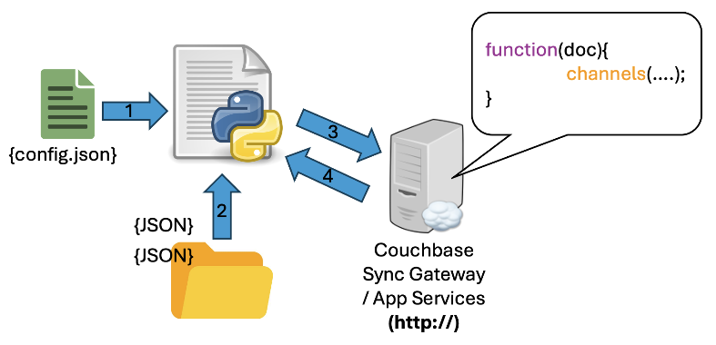

# Sync Gateway Sync Function Tester

> **This branch (`sg-4.x`) targets Sync Gateway 4.x and its version vectors.**
> For Sync Gateway 3.x (revision tree `_rev` IDs) use the
> [`sg-3.x-rest`](../../tree/sg-3.x-rest) branch.

## PROBLEM

Don't want to touch the Sync Gateway Sync Function with a 10-foot pole because who knows what's going to happen to your writes and channel process when you change it?

## SOLUTION

I wrote this simple Python script to test the Sync Function of Sync Gateway with CRUD operations from:
- different users
- different docTypes

## WHAT IT DOES




This script will:

1. read a `config.json` file with your settings(usernames , URLs & commands)
2. opens a folder of individual JSON files: default folder `jsons`
3. process each of the JSON file in the folder as HTTP [GET, PUT, DELETE, CHANGES, GET_ADMIN, PUT_ADMIN, DELETE_ADMIN , CHANGES_ADMIN and/or PURGE] against your SG endpoint to test your Sync Function
4. writes the results into a log file as `failed` or `success` by HTTP type & timestamp

**NOTE:** a `failed` PUT might be a good thing as the Sync Function is denying a particular write.

The script will do all the above as different user(s) from the `config.json` file.

## REQUIREMENTS 
- A running **Sync Gateway 4.x** with one or more known Sync Gateway USERS (cbl user). Don't have one? See [Local SG 4.x test stack](#local-sg-4x-test-stack-docker).
- Python 3
- Python Requests Library: https://docs.python-requests.org/en/latest/index.html

To install the required library:
```sh
pip install requests
```

## SYNC GATEWAY 4.x: VERSION VECTORS

Sync Gateway 4.0+ tracks document versions with a **version vector**
(Hybrid Logical Vector, HLV) instead of the CouchDB-style revision tree.
Every document now has a **Current Version (CV)**, returned as `cv` on writes
and `_cv` on reads:

```json
{"_id": "foo", "_rev": "1-092afbe9a5776a13d72efe4dd780051b",
 "_cv": "18e8e11501350000@+RTUz3ZWvU8ktL6AuG0csA", "channels": ["bob"]}
```

A CV is `<version>@<source ID>`. Treat it as an opaque string. `_rev` is still
returned so Couchbase Lite clients older than 4.0 keep working, but
conflicts are now settled by the version vector (last write wins).

What the tester does differently on 4.x:

| | SG 3.x branch | SG 4.x branch (this one) |
|---|---|---|
| Version sent on `PUT` | body `_rev` | body `_cv` (current CV, read first) |
| Version sent on `DELETE` | `?rev=<rev>` | `?rev=<URL-encoded CV>`. CVs contain `@` and `+`, and an unencoded `+` gets a `400` |
| `_rev` / `_cv` in your JSON files | sent as-is | stripped; the tester always sends the live CV |
| `CHANGES` | `changes: [{"rev": ...}]` | adds `version_type=cv`, so `changes: [{"cv": ...}]` |
| `GET_RAW` | `_sync` | also logs the `_vv` xattr (the version vector: `src`, `ver`, ...) |
| New `CONFLICT` op | – | writes with a stale CV and expects `409` |
| Failed request | logged as `null` | logged with status + SG reason, e.g. `{"status": 403, "error": "Forbidden", "reason": "sg missing role"}` |

The `reason` on a 403 is the message from your Sync Function
(`throw({forbidden: "..."})`, `requireRole`, `requireAdmin`, ...), so you can
see *why* a write was denied.

If a user is allowed to write a document but not read it, the tester reads the
current CV through the admin port (when admin credentials are configured) so
the Sync Function's decision on the write is still tested. The log shows an
`[info]` line when this happens.

Docs: [Sync Gateway: Version Vectors (4.0+)](https://docs.couchbase.com/sync-gateway/current/manage/revisions.html#version-vectors-4-0) ·
[HLV data in xattrs](https://docs.couchbase.com/server/current/learn/clusters-and-availability/xdcr-enable-crossclusterversioning.html#hlv-data-maintained-in-xattr)

## HOW TO USE

**Step 1.** Update the `config.json` with your Sync Gateway hostname, one or more CBL test users, and other settings you want.

**Step 2.** In the folder specified in your config (default is `jsons`), put sample JSON docs as individual files. Example: `{"_id":"foo","channels":["bob"]}` saved in a file `foo.json`.  

**Step 3.** Run the Python code 

```sh
python3 sg_sync_function_tester.py config.json
```

**OUTPUT:** It will output a log file of the run: `sync_gateway_log_{date}_{time}.log`

Example output:
```
2026-11-17T10:14:15.509 - INFO - [info] - Sync Gateway version 4.1
2026-11-17T10:14:15.524 - INFO - [success] - [GET] - [bob] - GET result for [foo] - {"_cv": "18e8e131cd0c0000@+RTUz3ZWvU8ktL6AuG0csA", "_id": "foo", "_rev": "1-7386c0f700b338102e90403bca08d2cf", "channels": ["bob"], "dateTimeStamp": "2026-11-17T10:14:15.517366"}
2026-11-17T10:14:15.530 - INFO - [success] - [PUT] - [bob] - PUT result for [foo] - {"id": "foo", "ok": true, "rev": "2-5c9c41a168d0848aabdb2ef44427688d", "cv": "18e8e131cd8a0000@+RTUz3ZWvU8ktL6AuG0csA"}
2026-11-17T10:14:15.534 - INFO - [success] - [CONFLICT] - [bob] - CONFLICT result for [foo] (expect 409) - {"status": 409, "error": "conflict", "reason": "Document revision conflict"}
2026-11-17T10:14:15.549 - INFO - [failed] - [DELETE] - [bob] - DELETE result for [foo] - {"status": 403, "error": "Forbidden", "reason": "sg missing role"}
2026-11-17T10:14:15.631 - INFO - [failed] - [PUT] - [bob] - PUT result for [lk] - {"status": 403, "error": "Forbidden", "reason": "sg admin required"}

```

## Operations

The script supports the following operations:

- `GET`: Retrieve a document
    - `GET_RAW`: Retrieve a document with full meta data `_sync` and the `_vv` version vector (admin only)
- `PUT`: Create or update a document
- `DELETE`: Delete a document
- `CHANGES`: Get the changes feed. To filter channel(s) on the change just add your channel(s) names: `CHANGES:bob` or `CHANGES:bob,water`
- `CONFLICT`: `PUT` with a stale CV. Logged `[success]` when Sync Gateway correctly rejects it with `409`
- `PURGE`: Purge a document (admin only)
- `SLEEP`: Pause execution for a specified number of seconds

Admin versions of operations are available by appending `_ADMIN` to the operation name (e.g., `GET_ADMIN`, `PUT_ADMIN`, `CONFLICT_ADMIN`). `PURGE` and `GET_RAW` always run as admin, once per document.

<mark style="background-color: yellow;">**Warning**</mark>: If you do `CHANGES_ADMIN` without a channel filter like `CHANGES_ADMIN:bob` Sync Gateway will process your whole database `_changes` feed in the output.

### SLEEP Operation

The `SLEEP` operation allows you to introduce a delay between other operations. This can be useful for testing time-sensitive scenarios or rate limiting.

- `SLEEP`: Pauses execution for 1 second
- `SLEEP:X`: Pauses execution for X seconds (where X is an integer)

Example usage in the `operations` list(sleeps for 3 seconds):

```json
"operations": [
    "PUT_ADMIN",
    "SLEEP:3",
    "GET",
    "SLEEP",
    "DELETE"
]
```


## EXAMPLES

You can copy and paste the `config.json` file and rename them to run tests. `example_config` folder has below examples.

```sh
python3 sg_sync_function_tester.py 1.user_put-user_get.json
python3 sg_sync_function_tester.py 2.user_put-user_changes.json
python3 sg_sync_function_tester.py 3.admin_put-user_delete.json
python3 sg_sync_function_tester.py 4.sg4_cv_conflict.json
```
**PRO TIP** The config `3.admin_put-user_delete.json` is a great way to see if the user can delete "READ-ONLY" documents.

## config.json

```json
{
    "sgHost": "http://localhost",
    "sgPort": "4984",
    "sgAdminPort": "4985",
    "sgDb": "sync_gateway",
    "sgDbScope":"_default",
    "sgDbCollection":"_default",
    "sgTestUsers": [
        {"userName": "bob", "password": "12345", "sgSession": ""}
    ],
    "sgAdminUser": "Administrator", // Required if you want to do Admin Operations
    "sgAdminPassword": "password",  // Required if you want to do Admin Operations
    "jsonFolder": "jsons",   // Folder containing all your individual json files
    "logPathToWriteTo": "sync_gateway_log",
    "debug": false,
    "operations": ["GET", "PUT", "CONFLICT", "DELETE", "CHANGES", "GET_ADMIN", "PUT_ADMIN", "DELETE_ADMIN", "CHANGES_ADMIN","SLEEP:3","GET_RAW","PURGE"]  // Specify the order of operations and/or indivdual operations
}
```

### **Scopes and Collection**
If your not using scopes and collections for mobile yet just leave the default values of: `"sgDbScope":"_default"` and `"sgDbCollection":"_default"`. This script will not test all your collections at once. You have to have a different `config.json` for each collection Sync Function.

### **PRO TIP**
"PURGE" is a great way to clean up data between tests. It literally 100% removes the document from Sync Gateway and the Couchbase Bucket. NOTE: PURGE is a Sync Gateway Admin function. In the config.json, you'll need to add Sync Admin (Couchbase Server RBAC [`Sync Gateway Architect`](https://docs.couchbase.com/server/current/learn/security/roles.html#sync-gateway-configurator) ) credentials for `sgAdminUser` and `sgAdminPassword`. Link here for [Offical Docs for: POST {db}/_purge](https://docs.couchbase.com/sync-gateway/current/rest-api-admin.html#/Document/post_keyspace__purge)


## LOCAL SG 4.x TEST STACK (Docker)

`docker/` brings up Couchbase Server 8.0.3 + Sync Gateway 4.1.2 with a
sample Sync Function ([docker/sync-function.js](docker/sync-function.js)) and
user `bob` / `12345`, matching the default `config.json`:

```sh
docker compose -f docker/docker-compose.yml up -d
./docker/setup.sh
python3 sg_sync_function_tester.py config.json
```

- Sync Gateway: public `http://localhost:4984`, admin `http://localhost:4985` (`Administrator` / `password`)
- Couchbase Server UI: `http://localhost:28091` (not published on 8091, so it won't clash with a local Couchbase install)
- Tear down: `docker compose -f docker/docker-compose.yml down -v`

The sample Sync Function denies `DELETE` without the `editor` role, denies
updates to `"locked": true` docs unless admin, and requires a `channels` field.
So `bob` gets useful `403`s to look at.

**Note:** XDCR between buckets in a Sync Gateway 4.x deployment requires
Couchbase Server 7.6.6+ and the bucket property `enableCrossClusterVersioning`.
It cannot be set when the bucket is created and cannot be turned off once
enabled. A single-cluster test setup like this one doesn't need it.

## UNDERSTANDING THE SYNC FUNCTION
Here is a link to understand what the Sync Function can and can not do.
- [Offical Docs for Sync Gateway's Sync Function](https://docs.couchbase.com/sync-gateway/current/sync-function.html#ex-sync-function)

#### Sample Sync Functions:
- [Github.com - Sync Function with Security](example_sync_functions/3.sync_function_run.js)
- [Github.com - sync_gateway](https://github.com/couchbase/sync_gateway/blob/main/examples/database_config/sync-function.json)
- [Github.com - travel-sample](https://github.com/couchbaselabs/mobile-travel-sample/blob/master/sync-gateway-config-travelsample-docker.json#L65)
- [Github.com - todo](https://github.com/couchbaselabs/mobile-training-todo/blob/release/helium/docker/sg-setup/config/sync-function.json#L7)


### Key Changes:
1. **Updated the `operations` Configuration**: Added an `operations` attribute to specify the list of operations to perform.
2. **Dynamic Operation Execution**: The script now executes operations in the order specified in the `operations` array.
3. **Clarified Usage Instructions**: Updated the usage instructions to reflect the new configuration options.
4. **Admin Operations**: Your Sync Function might have certain restrictions at a USER level, but you still need to GET and PUT docs. There are now admin equivalents to the operations.
5. **Sleep Operation**: Added a new `SLEEP` operation that allows pausing execution between other operations. This can be useful for testing time-sensitive scenarios or simulating delays.
6. **HTTP GET /_raw/{docId}**: Added a new `GET_RAW` operation that allows you to get the document from Sync Gateway exactly how it is stored in Couchbase Server includes all the meta / bookkeeping data from `_sync`.
7. **Scopes and Collection**: In the `config.json` just pass in non-default(`_default`) value for `sgDbScope` and `sgDbCollection` to test scopes and collection Sync Functions.
8. **Changes Channel(s) Filter**: Add the channel(s) you want to filter by in the changes operation like this:`CHANGES:bob` .
9. **Sync Gateway 4.x / Version Vectors**: Writes and deletes use the document's Current Version (`_cv`) instead of `_rev`; CVs are URL-encoded; `CHANGES` uses `version_type=cv`; `GET_RAW` logs the `_vv` xattr.
10. **CONFLICT Operation**: Verifies that a write with a stale CV is rejected with `409`.
11. **Failure Reasons in Logs**: Failed requests log the HTTP status and Sync Gateway's reason (e.g. the Sync Function's `forbidden` message) instead of `null`.
12. **Scopes & Collections fixes**: `CHANGES` and `PURGE` now use the configured scope/collection keyspace.
13. **Docker test stack**: `docker/` spins up Couchbase Server + Sync Gateway 4.x locally.


Works on My Computer - Tested & Certified ;-)